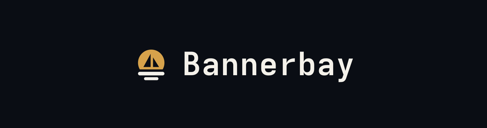

# Bannerbay

Make README banners and social cards in seconds, right in your browser.


## Description

A good README banner or social card usually means opening a design tool. Bannerbay does only that job: pick a theme,
type your copy, add a logo, and download a crisp PNG or SVG. It is a static WebAssembly site, so there is no server,
no sign-up, and nothing you create ever leaves your browser.

## Features

- **Sizes:** README banner (1520×400), social/OG card (1200×630), square, and 16:9.
- **Themes:** six one-click looks (Midnight, Paper, Neon, Ocean, Sunset, Forest), shown as thumbnails of your own banner.
- **Fonts:** pick a heading font and a body font from 14 bundled, open-licence Google fonts (JetBrains Mono, Inter,
  Playfair Display, Bebas Neue and more) or your system's. They are embedded in PNG and SVG exports.
- **Backgrounds:** solid, gradient, grid or dots, with an accent glow and rounded corners.
- **Text:** name, tag, header, description and a badge in the top-right corner. Wrap header words in `*asterisks*` to
  colour them with the Highlight colour (`\*` for a literal asterisk).
- **Features list:** horizontal pills, or a vertical column of pills on the right.
- **Logo:** built-in marks (blocks, rings, sail) or your own PNG, SVG or JPG. Clear the header, description, tag and
  features and the logo and name scale up into a centred lockup.
- **Style sliders:** corner radius, size, padding, spacing, weight, line height and more for the pills, badge, logo,
  name, header, description and tag, each with a reset button.
- **Export:** PNG at 1× or 2×, or SVG.
- **Autosave:** your banner is saved in the browser and restored when you come back.

## Getting Started

### Requirements

- [Rust](https://www.rust-lang.org/tools/install) with the WebAssembly target
- The [Dioxus CLI](https://dioxuslabs.com/learn/0.7/getting_started) (`dx`)

### Install

```bash
rustup target add wasm32-unknown-unknown
cargo install dioxus-cli
```

### Usage

```bash
dx serve              # dev server with hot reload, on http://localhost:8080
dx build --release    # static site in target/dx/bannerbay/release/web/public
```

The release output is plain static files, so it can be hosted anywhere.

## Saved in your browser

Settings are autosaved to the browser's localStorage on every change. Nothing is sent anywhere and no cookies are used.
The "Reset everything" button at the bottom of the side panel clears them. A very large uploaded logo may not fit in
localStorage; the rest is still saved and you get a warning.

## How it works

`render::render(&Config)` is a pure function that returns an SVG string. The live preview injects that string, and the
PNG and SVG exports serialise the same element, so a download always matches what you see. PNG export draws the SVG onto
a canvas at 1× or 2×. The theme thumbnails use the same renderer with their own id prefix, because SVG ids are
page-global.

## Testing

```bash
cargo test
```

The layout, wrapping, emphasis parsing, themes (including a contrast check) and autosave formats are tested natively. The
default look is pinned by golden SVG files in `tests/golden`; regenerate them on purpose with
`BB_UPDATE_GOLDEN=1 cargo test`.

## Fonts

The bundled fonts are variable (or single-weight) Latin subsets from [Fontsource](https://fontsource.org), all under the
SIL Open Font License; the licences are in `assets/fonts/licenses`. Exports embed the fonts a banner uses, so a PNG or SVG
looks the same on any machine.

## Known limits

- Text wrapping and pill sizes use average glyph widths, so they are approximate. A warning appears if content overflows
  the canvas.

## License

MIT, see [LICENSE](LICENSE).
